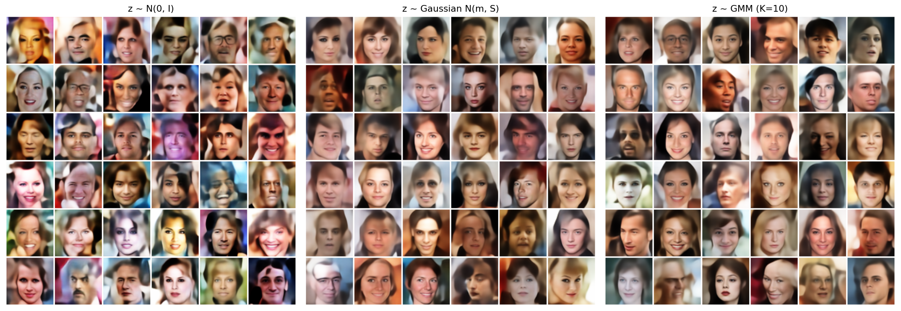
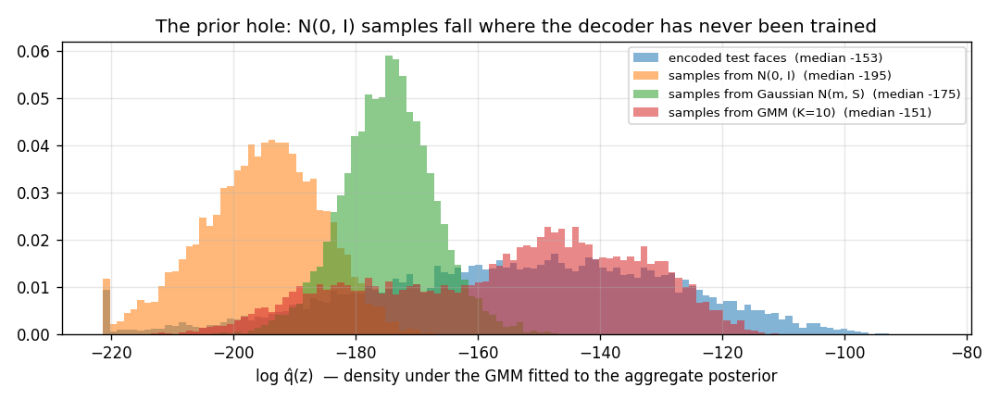
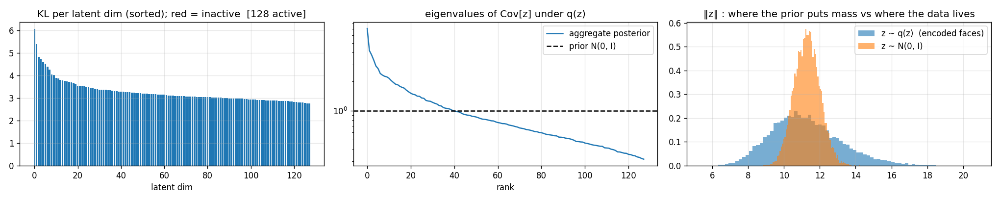
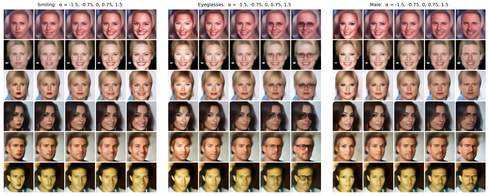
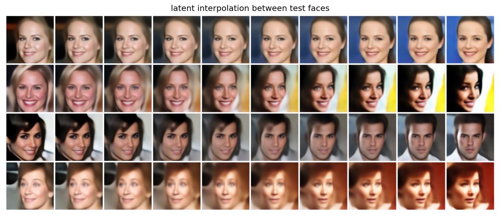
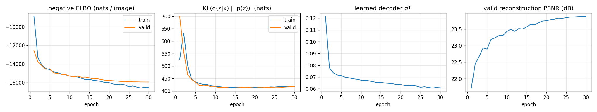

# Mind the Prior Hole: Variational Autoencoders on CelebA

A σ-VAE trained on **162,770 real face images** (CelebA, 64×64), and a study of **why sampling from the prior fails** and how a prior learned after training fixes it.

<p align="center">
  
</p>
<p align="center"><i>Same decoder, same weights. Only the distribution we sample z from changes.</i></p>

## Results

| Sampling prior | FID ↓ (10k vs 10k test faces) |
|---|---|
| N(0, I), the prior the VAE was trained with | 92.2 |
| Full-covariance Gaussian fitted to q(z) | 67.2 |
| **Gaussian mixture (K=10) fitted to q(z)** | **61.0** |
| *Reconstructions (lower bound for this decoder)* | *53.3* |

Fitting a prior to the aggregate posterior **closes ~80% of the gap** between N(0, I) and the reconstruction bound, without retraining the autoencoder.

## The idea

A VAE maximises the ELBO with a fixed prior p(z) = N(0, I). Averaged over the data, the KL term splits into two parts ([Hoffman & Johnson, 2016](http://approximateinference.org/accepted/HoffmanJohnson2016.pdf)):

$$
\mathbb E_{p(x)}\big[\mathrm{KL}(q(z\mid x)\,\|\,p(z))\big] = I_q(x;z) + \mathrm{KL}\big(q(z)\,\|\,p(z)\big)
$$

Good reconstructions need a large mutual information $I_q(x;z)$, so the optimiser cannot also make the **aggregate posterior** $q(z)$ match the prior. $q(z)$ leaves *holes*: regions that the prior samples often but the decoder never saw during training. Samples from N(0, I) land there and decode to distorted faces.

The fix is the one modern latent generative models use (two-stage VAE, VQ-VAE + PixelCNN, latent diffusion): **let the autoencoder learn the representation, and let a separate model learn where in that representation the data lives.**

## Measuring the hole

<p align="center"></p>

Density assigned by a model of q(z) to codes of real test faces and to samples from each prior. N(0, I) samples fall in low-density regions. Mixture samples overlap the real codes.

<p align="center"></p>

* **All 128 latent dimensions are active.** The model uses its whole code (≈419 nats of KL per image).
* **The aggregate posterior is anisotropic.** The eigenvalues of Cov[z] range from 7.07 down to 0.32, where the prior would give 1 everywhere.
* **Norms do not match.** Prior samples concentrate on a thin shell of radius √128 ≈ 11.3. Encoded faces spread much wider.

## Latent space

<p align="center"></p>

Attribute directions computed from CelebA's 40 labels as $v_a = \mathbb E[\mu(x)\mid a] - \mathbb E[\mu(x)\mid \neg a]$ and applied to faces from the test set, which the model never saw: *Smiling*, *Eyeglasses*, *Male*.

<p align="center"></p>

## Model and training

* **Data:** CelebA aligned & cropped, official splits (162,770 train / 19,867 valid / 19,962 test, disjoint identities). 148×148 centre crop resized to 64×64. Loaded from the [`flwrlabs/celeba`](https://huggingface.co/datasets/flwrlabs/celeba) mirror on the Hugging Face Hub.
* **Architecture:** convolutional encoder and decoder with residual blocks (64→512 channels, 20.1M parameters), 128-d diagonal Gaussian posterior. The decoder uses nearest-neighbour upsampling to avoid checkerboard artifacts.
* **Likelihood:** σ-VAE ([Rybkin et al., 2021](https://arxiv.org/abs/2006.13202)). A Gaussian decoder whose shared variance is set to its analytic optimum at every step, so the reconstruction/KL balance is learned and there is no β to tune.
* **Optimisation:** Adam, warm-up and cosine decay, fp16 mixed precision, KL annealing, horizontal flips. The whole dataset is kept on the GPU as uint8.
* **Budget:** 30 epochs (19k steps) in 56 minutes on a single free Colab T4. Validation PSNR 23.9 dB.
* **Learned priors:** a full-covariance Gaussian, and a 10-component full-covariance GMM, both fitted on posterior samples of the training set after training.
* **Evaluation:** FID with `torchmetrics` (Inception-v3, 2048-d), 10k generated images against 10k test images.

<p align="center"></p>

## Run it

Open `vae_celeba_prior_hole.ipynb` in Google Colab, choose a T4 GPU, and run all cells (~1 h 20 min in total: ~11 min of data preparation, 55 min of training, ~10 min of analysis). The training loop measures the GPU's speed and stays inside a fixed time budget.

## Trained weights

The weights (`vae_celeba64.pt`, 80 MB) are attached to the [latest release](../../releases/latest). The model is defined in section 3 of the notebook. To use the weights, run the cells of sections 1–3, then:

```python
ckpt = torch.load("vae_celeba64.pt", map_location=device)
model.load_state_dict(ckpt["model"]); model.eval()
with torch.no_grad():
    faces = model.dec(torch.randn(16, CFG["z_dim"], device=device))   # (16, 3, 64, 64) in [0, 1]
```

These samples come from the N(0, I) prior. The GMM prior that gives the better samples is fitted in section 9 and is not stored in the checkpoint.

## Repository

```
vae_celeba_prior_hole.ipynb   notebook: data, model, training, analysis
figures/                      all figures in this README, plus a GIF of training progress
results.json                  final metrics (test ELBO, PSNR, active units, FID)
history.json                  per-epoch training and validation metrics
```

## References

* Kingma & Welling (2014). *Auto-Encoding Variational Bayes.*
* Hoffman & Johnson (2016). *ELBO surgery: yet another way to carve up the variational evidence lower bound.*
* Burda, Grosse & Salakhutdinov (2016). *Importance Weighted Autoencoders.*
* Tomczak & Welling (2018). *VAE with a VampPrior.*
* Dai & Wipf (2019). *Diagnosing and Enhancing VAE Models.*
* Ghosh et al. (2020). *From Variational to Deterministic Autoencoders.*
* Rybkin, Daniilidis & Levine (2021). *Simple and Effective VAE Training with Calibrated Decoders.*
* Liu et al. (2015). *Deep Learning Face Attributes in the Wild.*

CelebA is released for non-commercial research purposes only. See the [CelebA agreement](https://mmlab.ie.cuhk.edu.hk/projects/CelebA.html).
